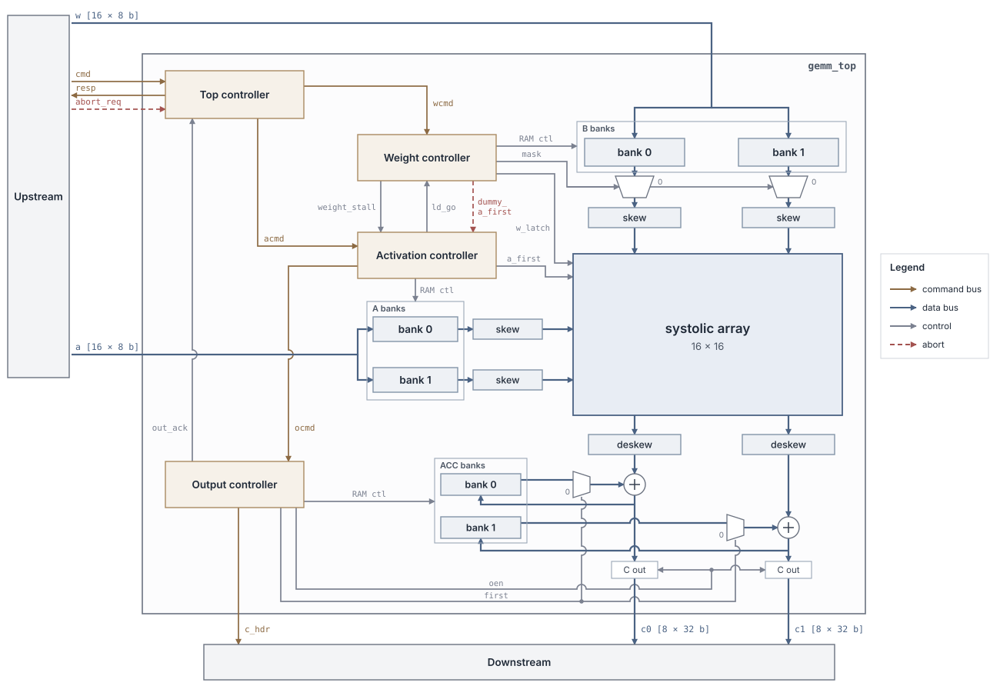

# GEMM Engine

A tiled integer GEMM accelerator in SystemVerilog, built around a 16×16 weight-stationary systolic array
with double-buffered weights. It computes **C = A · B** for signed int8 matrices of any shape
(M, K, N from 1 to 65 536) with exact int32 results, streaming tiles through the array back to back.

The design is verified against a reference matmul and taken through synthesis, place and route, gate-level
simulation and power analysis with an open-source flow (OpenROAD, Nangate45) meeting **770 MHz on a 0.50 mm² die**.
The [microarchitecture document](docs/microarch.pdf) describes the design; [`docs/implementation.md`](docs/implementation.md)
records the implementation flow and results.

## At a glance

| | |
|---|---|
| Array | One 16×16 weight-stationary array (256 MACs/cycle), handled as two 8-lane halves |
| Data types | int8 × int8 → int32 accumulate, signed, bit-exact (20-bit psums inside the array) |
| GEMM shapes | Any M, K, N in 1 … 65 536; edge tiles are zero-padded in hardware |
| Dataflow | k-innermost tiling; 16 A rows per weight tile ("pass"), one pass every 16 cycles |
| Weight loads | Hidden behind compute: each PE double-buffers its weight, so the next tile loads while the current one computes |
| Buffers | 1R1W banks: A and B ring buffers (2 × 32 rows each), 1 KB accumulator; flop arrays in synthesis |
| Control | One descriptor per GEMM {ID, M, K, N}; accept/end responses; abort |
| Throughput | ≈ 16 · ⌈M/16⌉⌈N/16⌉⌈K/16⌉ + 64 cycles; measured 90% at 48×48 · 48×64, 97% for four back to back |
| Implementation | 1.30 ns (770 MHz), 0.50 mm² die, Nangate45 typical corner; routed netlist bit-exact at gate level |
| Power | 168 mW at 500 MHz on an image filter bank (150 mW without the flop-based buffers) |

## Architecture



- **Width-split banks.** Every buffer is split into two 8-lane halves, bank 0 and bank 1. Bank 1 is read
  8 cycles after bank 0, which supplies the upper half's extra skew, so each path needs only two 0→7 skew
  triangles instead of a 0→15 one.
- **Tiling.** For each C block (r, n), the engine runs K/16 passes. Each pass holds one 16×16 B tile in the
  array, streams the matching 16 rows of A through it, and accumulates into the 16×16 int32 accumulator.
  The last pass of a block sends the result straight to the C output instead of writing it back.
- **Control.** A top controller (TC) walks the tile loops from the descriptor and issues pass commands to
  the weight (WC), activation (AC) and output (OC) controllers. WC and AC own their bank pointers and the
  input stalls, and hand off to each other directly so loads and passes overlap with no bubbles.

### Interfaces

| Bus | Dir | Payload |
|---|---|---|
| `cmd` | DVS in | GEMM descriptor {ID[3:0], M, K, N}, 16-bit element counts (0 = 65 536) |
| `resp` | DV out | {ID, done, info}: an accept (with zero-field warnings), then an end (OK or aborted) per GEMM |
| `abort_req` | in | One-cycle pulse: drops all work; every outstanding GEMM ends as aborted |
| `w` (B stream) | DVS in | One 16 × int8 row of B per beat, tiles in pass order |
| `a` (A stream) | DVS in | One 16 × int8 row of A per beat, tiles in pass order |
| `c0` / `c1` | DV out | C columns 0–7 / 8–15, 8 × int32 per beat; `c1` runs 8 cycles behind `c0` |
| `c_hdr` | DV out | Block header with each block's first `c0` row: block position, m/n sizes, GEMM ID |

The input streams carry data only: the engine knows every tile boundary from the descriptor, and upstream
(a testbench now, a DMA later) sends tiles in the loop order. DVS = data/valid/stall; DV = data/valid.

## Results

| | |
|---|---|
| Verification | End-to-end against a reference matmul: shapes 1–100 per dimension, K = 65 536, back-to-back GEMMs, aborts swept over every pass phase; a real workload (16 3 × 3 image filters via im2col) bit-exact on the RTL and the routed netlist |
| Timing | 1.30 ns (770 MHz) after routing, setup and hold met; critical path: PE weight register → 8 × 8 multiply → psum add |
| Area | 389 966 µm² of cells on a 0.50 mm² die (79% utilization) |
| Power at 500 MHz | 257 mW on random int8 GEMMs, 168 mW on the image filter bank, 57 mW idle (gate-level simulation) |
| Workloads | At 500 MHz: 4K grayscale video at 60 fps through the 16-filter bank; ResNet-18 at about 65 images/s (99 at 770 MHz, cycle model) |

## Repository layout

```
.
├── docs/
│   ├── microarch.pdf (.docx)     Microarchitecture document: design, interfaces, timing, results
│   ├── implementation.md         Implementation flow: synthesis, place and route, gate-level sim, power
│   ├── spec.md                   Original v1 specification and decision log
│   └── img/                      Top-level diagram
├── rtl/                          Generic modules shared by all versions (no project package)
│   ├── pe.sv                     Processing element with double-buffered, clock-gated weights
│   ├── systolic.sv               M×M array of PEs
│   ├── skew.sv                   Skew/de-skew triangles
│   ├── delay_line.sv             Parameterized delay line (skew building block)
│   ├── ram_1r1w.sv               1R1W SRAM wrapper (behavioral; can be swapped for a macro)
│   └── sync_fifo.sv              Small flop-based FIFO for control queues
├── prj/v1/                       GEMM engine v1
│   ├── gemm_v1_pkg.sv            Widths, geometry, bank depths, descriptor/command/response formats
│   ├── gemm_top.sv               Top level: array, skew, banks, controllers
│   ├── top_controller.sv         Descriptor sequencer: tile loops, pass commands, responses, abort
│   ├── weight_controller.sv      B banks, weight tile loads, column mask
│   ├── activation_controller.sv  A banks, pass start, a_first wavefront
│   ├── out_controller.sv         Accumulation, C output, block header
│   └── v1.f                      Design file list
├── syn/                          Synthesis, place and route with OpenROAD-flow-scripts (Nangate45)
│   ├── config.mk                 ORFS design config
│   ├── constraint.sdc            Clock and I/O constraints
│   ├── run.sh                    Runs ORFS in Docker: synthesis, timing, place and route
│   ├── sta.tcl                   Pre-layout timing report
│   └── area_by_module.py         Per-block area from a hierarchical synthesis
├── LICENSE
└── README.md
```

## Running

Requires [Icarus Verilog](https://github.com/steveicarus/iverilog) 12 and/or
[Verilator](https://www.veripool.org/verilator/) 5. Run from the repository root.

The repository holds the design only; the testbenches used to bring it up are not part of it. These commands
elaborate and lint the design:
```
mkdir -p build
iverilog -g2012 -c prj/v1/v1.f -s gemm_top -o build/gemm_top.vvp
verilator --lint-only -Wall -f prj/v1/v1.f --top-module gemm_top
```
Verilator reports width and unused-signal warnings; none is a functional bug.

Synthesis and timing run in the OpenROAD-flow-scripts Docker image (needs Docker); results go to `build/syn/`.
Pre-layout synthesis and timing, then the final layout:
```
syn/run.sh
LEC_CHECK=0 INFER_CLKGATES=1 HOLD_SLACK_MARGIN=0.05 SETUP_SLACK_MARGIN=0.01 CORE_UTILIZATION=75 PLACE_DENSITY=0.82 \
    VARIANT=cg_pnr_1300_u75s CLK_PERIOD=1.3 syn/run.sh pnr
```

## Roadmap

- **v1.1:** int32 → int8 requantization and activation at the output controller, so one layer's output can
  feed the next.
- **Power:** gate the whole array's clock when no pass is in flight; mask padding lanes; SRAM macros for the
  buffers.
- **v2:** the same 16×16 array rebuilt from four 8×8 instances of the same `pe` / `systolic` RTL, with muxes at
  the core boundaries, so the cores can run independently or be regrouped (N-split, K-split) for small or odd
  shapes. Sharing the core RTL lets the cost of that flexibility (area, timing, control) be measured directly
  against the utilization it buys.
- Later: DMA/AXI front end, output backpressure, a Python layer that lowers convolutions and einsums to the
  engine's streams.

## License

MIT License, see [LICENSE](LICENSE).
